# Five families of machine learning models for tumour diagnosis

**Which kind of learner works best when the data are small, redundant and errors have asymmetric costs?** One learner from each of Pedro Domingos' five "tribes" (decision tree, neural network, RBF SVM, Naive Bayes and a custom evolutionary classifier) compared on the Breast Cancer Wisconsin dataset (569 tumours, 30 features).

**Key results**
- The neural network (MCC 0.945) and the RBF SVM (0.943) lead, but with nested 5×5 cross-validation and a corrected t-test with Holm correction **only the decision tree is significantly worse**: the rest cannot be told apart (ceiling effect).
- What separates the models is **calibration**, not accuracy: Naive Bayes ranks cases well (AUC 0.988) but its log-loss is 0.388 versus 0.102 for the neural network.
- Choosing the decision threshold by misclassification cost (a missed malignant tumour = 5 false alarms) cuts expected cost by **4–31%** depending on the model.
- An evolutionary classifier written from scratch as a scikit-learn estimator (differential evolution, MCC as fitness) matches logistic regression, at **20–35 times** the compute cost.

**Skills shown:** Python, scikit-learn, nested cross-validation without data leakage, statistical testing, cost-sensitive classification, model calibration, custom estimators.

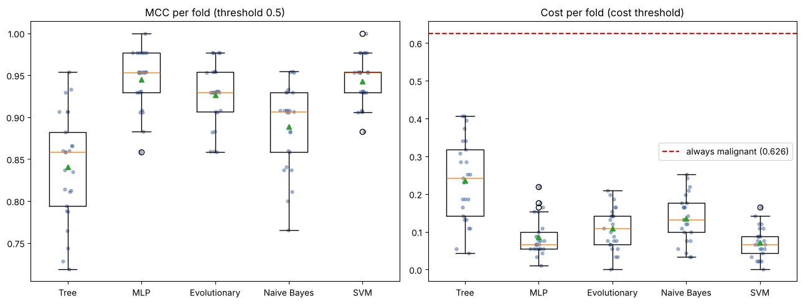

*Team project (2 students) for Fundamentos de Aprendizagem Automática (Machine Learning Fundamentals), University of Aveiro, autumn 2026.*

---

## 1. Summary

**Summary.** Only the decision tree is significantly worse. The multilayer perceptron (MCC 0.945), the RBF SVM (0.943), the evolved linear model (0.926) and Naive Bayes (0.889) **cannot be told apart** with 25 folds and a corrected t-test (ceiling effect). What does separate the classes is **calibration** and the cost of learning, not accuracy: Naive Bayes ranks cases well but is badly calibrated, and the evolutionary search reaches about the same place as the gradient at roughly 20 to 35 times the cost.

**About the numbers.** All figures in this README come from one reference run (Python 3.13, library versions in Section 4). Another machine or Python version can change the third decimal of some results: on a second machine (Windows, same library versions, numpy 2.5.4) the MLP's training MCC was 0.991 instead of 0.995, its outer-CV MCC 0.944 instead of 0.945, and its log-loss 0.106 instead of 0.102. The other four learners gave identical figures. The MLP's cost threshold on the test set also changed (see Figure 16), and so did the speed ratio of Section 5. The conclusions do not depend on any of this.

---

## 2. Models

One learner per class, all from scikit-learn except the evolutionary one (pyBlindOpt). The code is in `models_python.py`.

| Class | Learner | Why it was chosen for this problem | Preprocessing |
|:--|:--|:--|:--|
| **Symbolist** | Decision tree (CART) | Produces "if-then" rules a doctor can read; it picks one feature per node, so redundancy hardly affects it | none |
| **Connectionist** | `MLPClassifier` (backpropagation, L-BFGS solver) | The course's neural network; L2 regularization handles collinearity and the sigmoid output gives probabilities | [`log1p`] + standardize |
| **Evolutionary** | Linear classifier `sign(w·x + b)` whose **31 parameters are evolved by Differential Evolution** (pyBlindOpt); fitness = MCC on the training data | Evolution **is** the learning, and it optimizes a non-differentiable metric directly (MCC is a step function, so the gradient is useless) | [`log1p`] + standardize |
| **Bayesian** | Gaussian Naive Bayes | Applies Bayes' rule with conditional independence, which is violated here (21 feature pairs with \|r\| > 0.9): it lets us study overconfidence | [`log1p`] |
| **Analogizer** | SVM with RBF kernel, with Platt calibration | Classifies by similarity with training cases (support vectors); the maximum margin is robust with little data | [`log1p`] + standardize |

`[log1p]` is optional: the inner validation decides it, not the test set. The tree does not use it because it is invariant to monotone transformations.

### Justification of borderline classes

- **Tree → symbolist.** CART builds its rules greedily (maximizing information gain), not by strict inverse deduction; it is classed as symbolist because its output is a set of logical rules.
- **SVM → analogizer.** The decision function is a sum of similarities (RBF kernel) with the training cases that act as support vectors (56 of the 455 training tumours in the Phase 4 fit).
- **Evolutionary.** The model is linear, like a logistic regression; what makes it evolutionary is **how it learns**: a population of 40 candidates that mutates and crosses over for 100 generations, with no gradient (4,040 fitness evaluations per fit), weights bounded in [-5, 5]. Evolution is not used to tune hyper-parameters. Its probabilities (sigmoid of the linear output) are **not calibrated**, because evolution does not optimize them.
- **MLP → connectionist.** We use `MLPClassifier`, which the assignment allows. We did not use JAX or Keras (see limits).

### Search spaces

Selection criterion: mean MCC of a 3-fold inner cross-validation; ties are broken by the first value in the grid.

| Learner | Search space | Configurations |
|:--|:--|:-:|
| Tree | criterion {gini, entropy} × `max_depth` {2, 3, 4, 5, 6, none} × `min_samples_leaf` {1, 2, 5, 10} | 48 |
| MLP | `log1p` {no, yes} × hidden layers {(4), (8), (16), (32, 16)} × `alpha` {1e-3, 1e-2, 1e-1, 1, 10, 100} | 48 |
| Evolutionary | `log1p` {no, yes}. Fixed budget: population 40, 100 generations, bounds [-5, 5] | 2 |
| Naive Bayes | `log1p` {no, yes} × `var_smoothing` {1e-11, 1e-9, 1e-7, 1e-5, 1e-3, 1e-1} | 12 |
| RBF SVM | `log1p` {no, yes} × `C` {0.1, 1, 10, 100, 1000} × `gamma` {1e-4, 3e-4, 1e-3, 3e-3, 0.01, 0.03, 0.1, 0.3} | 80 |

**The grids were widened three times.** In a first pass the inner CV picked the edge of the range (`gamma`, `var_smoothing`, the smallest network, `C`). We widened those ranges and repeated the whole tuning. The decision was based only on the inner-validation choices; no outer-fold scores or test scores were looked at. Some edge selections remain (Section 5, "Hyper-parameters chosen").

### Tuning cost (reference run, 25 outer folds; times vary with the machine and from run to run)

| Learner | Configurations | Time (min) | Mean inner MCC |
|:--|:-:|:-:|:-:|
| Tree | 48 | 0.61 | 0.871 |
| MLP | 48 | 1.73 | 0.949 |
| Evolutionary | 2 | 0.99 | 0.915 |
| Naive Bayes | 12 | 0.52 | 0.889 |
| SVM | 80 | 1.21 | 0.953 |
| **Total** | | **5.1** | |

The evolutionary learner has only 2 configurations but takes longer than the tree's 48: each fit costs 4,040 fitness evaluations.

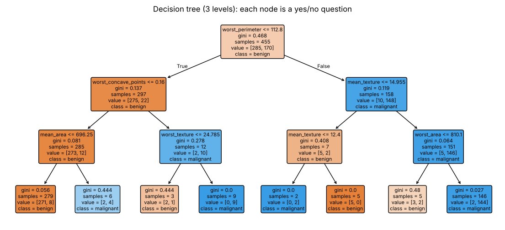

*Figure 1. A 3-level decision tree fitted on the training set.* Every node is a yes/no question on one feature, which is what makes the symbolist learner readable.

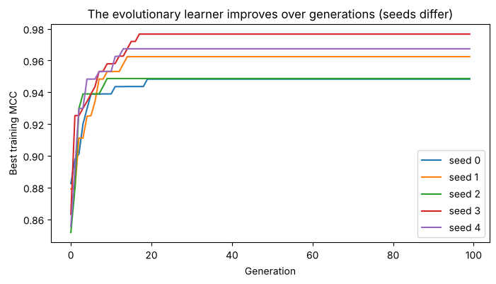

*Figure 2. Best training MCC per generation of the evolutionary learner, 5 seeds.* Every seed improves fast and stops improving between generation 9 and 19: the remaining ~80 generations add nothing. The seeds end at different values (training MCC from 0.948 to 0.977), a sign of **premature convergence**, typical of a step-shaped fitness function.

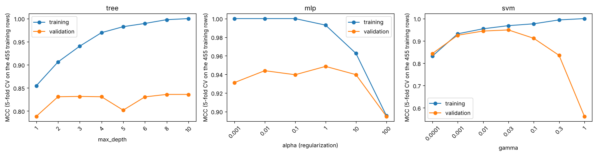

*Figure 3. Validation curves (MCC, 5-fold CV on the 455 training rows; other hyper-parameters at their default) for three learners.* The tree reaches a training MCC of 1.00 but its validation MCC stalls around 0.83 from depth 2: more complexity only memorizes. The MLP holds 0.93 to 0.95 for `alpha` between 0.001 and 10 and only drops to 0.895 at `alpha` = 100. The SVM peaks at 0.949 for `gamma` = 0.03 and **collapses to 0.562** at `gamma` = 1 while training stays at 1.00: the kernel becomes so local that each tumour only resembles itself.

---

## 3. Dataset

**Source.** UCI Machine Learning Repository, *Breast Cancer Wisconsin (Diagnostic)* (Wolberg, Street and Mangasarian), as distributed by the course repository (`datasets/breast_cancer.csv.zst`).
**Size.** 569 tumours × 30 numeric features (radius, texture, perimeter, area, smoothness, compactness, concavity, concave points, symmetry and fractal dimension of the cell nuclei, as mean, standard error and worst value). No missing values and no duplicates. **In the file `target = 1` means benign**; we recode it to `malignant = 1 - target` so the positive class is the one that matters (357 benign, 212 malignant).

**Why this dataset.** It is a health problem with asymmetric costs: missing a malignant tumour (false negative) is far worse than a false alarm. It is also "clean" with a ceiling effect, so the interest lies in how each class of learner handles redundancy and uncertainty, not in data cleaning. **Value of a good model:** a second opinion that does not tire and that allows a conservative threshold so malignant cases are not overlooked, without replacing the doctor's diagnosis.

### Data visualization and decisions

The split into 455 training rows and 114 test rows (20%, stratified, seed 42) is made **before** looking at the data. Everything below is computed on the 455 training rows only.

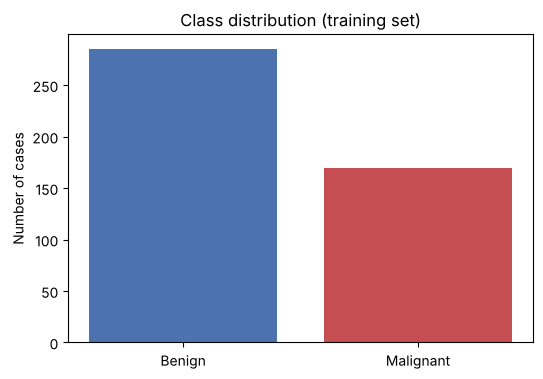

*Figure 4. Class balance (training set).* 62.6% benign and 37.4% malignant. **Decisions:** stratified splits; MCC as the main metric, not accuracy; baseline "always benign" (accuracy 0.626, MCC 0, recall 0).

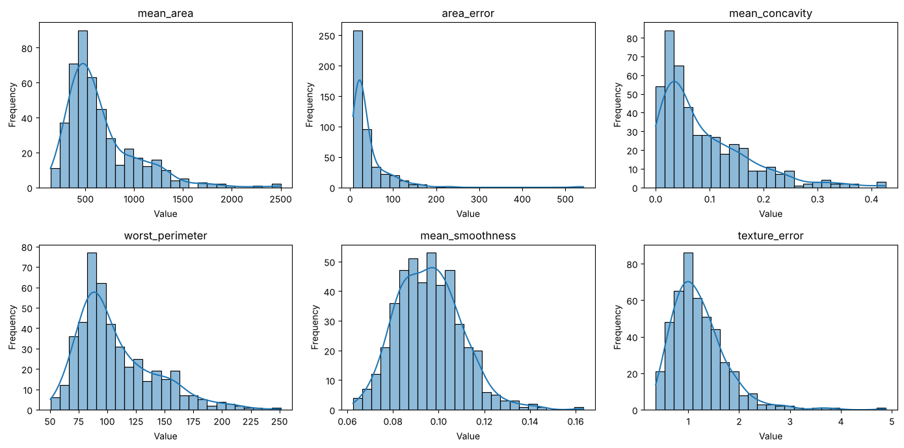

*Figure 5. Distribution of six representative features.* `mean_area`, `area_error` and `mean_concavity` have a long right tail; `mean_smoothness` is almost bell-shaped. Scales differ a lot: medians go from 0.003 (`fractal_dimension_error`) to 683 (`worst_area`), a factor of about 218,000. **Decision:** standardize inside each fold for MLP, SVM and the evolutionary learner; the tree does not need it.

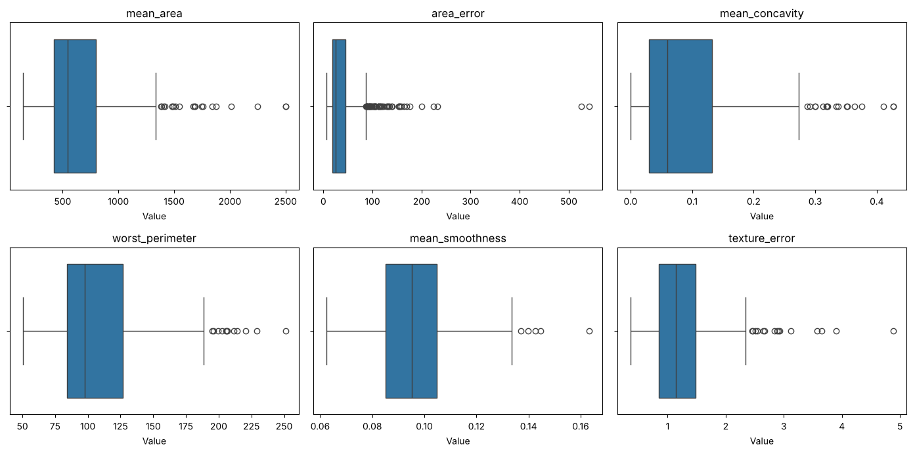

*Figure 6. Outliers (Tukey rule, 1.5 IQR).* The box plots show six features (e.g. `area_error` has 53 outliers, 12% of the rows). Counting all 30 features, 135 of the 455 tumours (30%) have at least one outlier, and they are **52% of the malignant versus 16% of the benign** tumours. **Decision:** **do not remove outliers**: they are real large or irregular tumours, exactly the ones that matter.

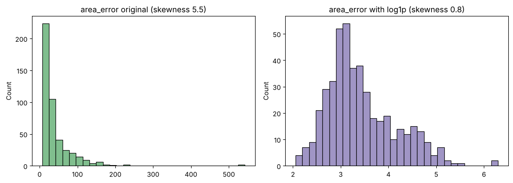

*Figure 7. Effect of `log1p` on `area_error`.* 23 of 30 features have skewness > 1; `log1p` lowers the mean skewness of those from 2.15 to 1.40 (it helps but does not make them symmetric); for `area_error` it falls from 5.5 to 0.8. **Decision:** `log1p` is an optional step chosen on validation, never applied to the tree.

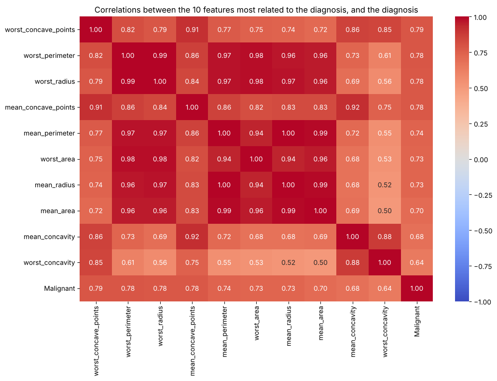

*Figure 8. Correlations among the 10 features most related to the diagnosis, and the diagnosis.* The most related are `worst_concave_points` (+0.79), `worst_perimeter` (+0.78) and `worst_radius` (+0.78); the least related have |r| < 0.01. 21 of 435 feature pairs have |r| > 0.9 (`mean_radius` with `mean_perimeter`: 0.998): size features measure nearly the same thing. **Decisions:** the independence assumption of Naive Bayes is clearly violated; L2 regularization; **no manual feature selection** (it would be leakage if done outside the fold).

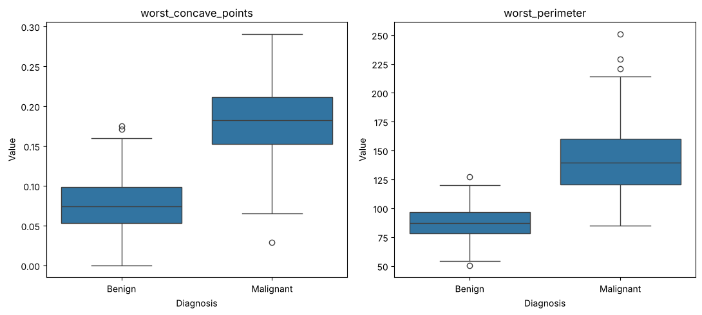

*Figure 9. The two features most related to the diagnosis, split by class.* The boxes barely overlap. A single threshold on `worst_concave_points` already classifies 91.9% correctly, against 62.6% for "always benign": a **ceiling effect**. **Decisions:** repeated CV and a corrected t-test, because differences will be small; the remaining overlap justifies choosing the threshold by cost.

### Hypothesis

Success will not depend on drawing complex boundaries but on how each paradigm handles **redundancy** and allows **calibrating a threshold** under asymmetric costs. We expected: (1) the **connectionist** dominates thanks to regularization and calibrated probabilities; (2) the **Bayesian** is overconfident, with worse threshold tuning; (3) the **symbolist** is readable but worse calibrated; (4) the **analogizer** is hurt by correlated features; (5) the **evolutionary** can optimize cost directly but is very inefficient compared with the gradient. Tested in Section 5.

### Dataset limits

1. **Size:** 569 rows. A single split would give an unstable estimate; hence repeated CV.
2. **Ceiling effect:** many learners approach 95% or more; showing one is better than another is hard.
3. **Collinearity:** destabilizes unregularized weights and violates the independence of Naive Bayes.
4. **Asymmetric costs:** the default 0.5 threshold is inadequate. **The 5:1 cost we use is our own assumption** (taken from the 5:1 of `german_credit`), not clinical data.
5. **One institution and one dataset:** no external validation.

---

## 4. Methodology

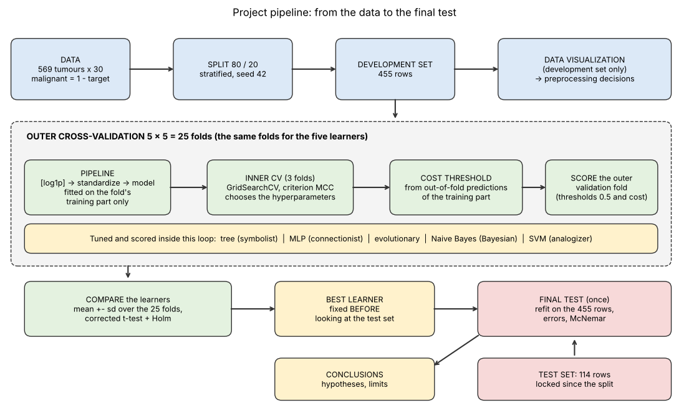

*Figure 10. Pipeline of the project, from the data to the final test, with the five learners.* The data are split once into development (80%) and test (20%, locked). Visualization uses only the development set. A repeated outer cross-validation compares the five learners on the **same folds**; inside each fold, preprocessing, tuning and threshold see only that fold's training part. The test set is used once, after the best learner has been fixed.

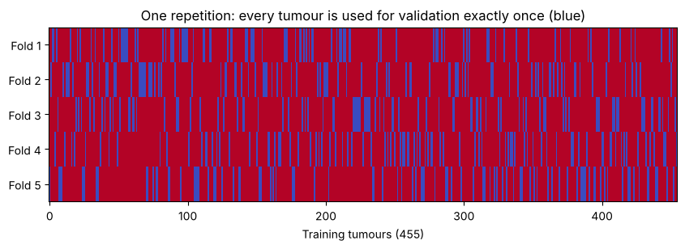

*Figure 11. One repetition of the outer cross-validation: every training tumour is used for validation exactly once (blue).*

**Split.** 20% final test (114 rows, 42 malignant), stratified, seed 42, touched only once. Development: 455 rows. Comparison: **5 × 5 stratified outer CV** (25 folds of 364 training and 91 validation rows); the same seed gives the same folds to all five learners (paired comparison).

**Metrics.** MCC (main; not inflated by the majority class), recall on malignant, precision, F1, ROC-AUC (ranking), Brier and log-loss (calibration), accuracy (informative only) and **cost = (5·FN + FP) / n**. The threshold is chosen by minimizing cost on **out-of-fold predictions of the training data** (never the validation fold or the test set); each learner is reported with the 0.5 threshold and with the cost threshold.

**Baselines.** "Always benign": accuracy 0.626, MCC 0, recall 0, cost 1.87. "Always malignant": recall 1, cost 0.63. With asymmetric costs the second is better; the real floor to beat is a **cost of 0.63**.

**Spread and significance.** Mean, standard deviation and 95% CI per fold; **Nadeau and Bengio's corrected t-test** by pairs (variance corrected by the factor 1/k + n_test/n_train because folds share data), with **Holm correction** for the 10 comparisons. On the final test, exact McNemar.

**Preprocessing (always inside a `Pipeline`, fitted only on each fold's training part).**

| Learner | Steps | Why |
|:--|:--|:--|
| Tree | none | The questions "x < threshold" are invariant to scale and monotone transformations |
| MLP | [`log1p`] + standardize | Gradient descent degrades with scales differing by 5 orders of magnitude |
| Evolutionary | [`log1p`] + standardize | Weights are bounded in [-5, 5]: they only make sense with comparable inputs |
| Naive Bayes | [`log1p`] | Estimates a mean and variance per class: no scaling needed, but it assumes a Gaussian shape |
| SVM | [`log1p`] + standardize | Without scaling the kernel is dominated by `area` and `perimeter` |

No imputation or de-duplication (0 missing, 0 duplicates). Outliers are kept.

**Tuning protocol (nested CV).** For each of the 25 outer folds: a 3-fold `GridSearchCV` on that fold's training part alone selects hyper-parameters by MCC; out-of-fold predictions (3 folds) of the same training part fix the cost threshold; the refitted model scores the outer validation fold. For the final test, each learner is refitted on the **whole development set** with the same inner protocol and evaluated once.

**How data leakage is avoided.**
- Every step that learns something (`StandardScaler`) is inside the `Pipeline` and fitted only on each fold's training part. A check in Phase 3 verifies that the scaler's mean equals that of the fold's training data and not that of the whole dataset (it prints `True / True`).
- Neither hyper-parameter selection nor threshold selection uses the validation fold or the test set.
- There is no global feature selection.
- The "best" learner (MLP, by mean outer-CV MCC) was fixed **before** looking at the test set and not changed afterwards.
- Honesty note: the grid widenings (Section 2) were decided looking only at the inner-validation choices.

**Reproducibility.** All seeds fixed to 42 (split, folds, models, evolutionary search). Versions of the reference run: Python 3.13, scikit-learn 1.9.1, polars 2.1.0, numpy 2.5.3, scipy 1.18.1, matplotlib 3.11.2, seaborn 0.13.2, pyBlindOpt 0.5.0.

---

## 5. Evaluation and conclusion

### Outer-CV results (25 folds, 0.5 threshold, mean ± standard deviation)

| Class | MCC | Malignant recall | F1 | ROC-AUC | Brier | Log-loss |
|:--|:-:|:-:|:-:|:-:|:-:|:-:|
| Connectionist (MLP) | **0.945 ± 0.033** | 0.948 ± 0.034 | 0.964 | 0.994 | 0.021 | 0.102 |
| Analogizer (RBF SVM) | 0.943 ± 0.029 | 0.948 ± 0.030 | 0.963 | 0.994 | 0.021 | 0.082 |
| Evolutionary (DE) | 0.926 ± 0.036 | 0.938 ± 0.033 | 0.953 | 0.991 | 0.030 | 0.196 |
| Bayesian (NB) | 0.889 ± 0.050 | 0.913 ± 0.050 | 0.928 | 0.988 | 0.050 | 0.388 |
| Symbolist (tree) | 0.841 ± 0.064 | 0.886 ± 0.061 | 0.898 | 0.935 | 0.067 | 0.582 |
| *Baseline "always benign"* | 0 | 0 | | 0.5 | | |
| *Baseline "always malignant"* | 0 | 1 | | 0.5 | | |

95% CI of the MCC: MLP [0.931, 0.959]; SVM [0.931, 0.955]; evolutionary [0.911, 0.941]; Bayes [0.868, 0.909]; tree [0.814, 0.867].

With the **cost threshold** (fixed on each fold's training data): cost per patient 0.072 (SVM), 0.087 (MLP), 0.109 (evolutionary), 0.136 (Bayes), 0.236 (tree), versus **0.626** for the best baseline.


*Figure 12. MCC per fold at threshold 0.5 (left) and cost per fold at the cost threshold (right), 25 points per learner.* MLP, SVM and the evolutionary learner overlap almost completely: the spread between folds (±0.03) is larger than the difference between them (≤ 0.02). Bayes sits a step below and the tree is the worst and the most variable. All five clearly beat the baselines (MCC 0; cost 0.63, dashed red line).

### Significance (corrected t-test, Holm correction for 10 comparisons)

| Pair | MCC difference | p | Holm p |
|:--|:-:|:-:|:-:|
| Tree vs MLP | −0.104 | 0.0013 | **0.012** |
| Tree vs SVM | −0.102 | 0.0007 | **0.007** |
| Tree vs Evolutionary | −0.085 | 0.0118 | 0.094 |
| Tree vs Naive Bayes | −0.048 | 0.073 | 0.365 |
| MLP vs Naive Bayes | +0.056 | 0.028 | 0.171 |
| Naive Bayes vs SVM | −0.054 | 0.021 | 0.148 |
| Evolutionary vs Naive Bayes | +0.037 | 0.077 | 0.365 |
| MLP vs Evolutionary | +0.019 | 0.315 | 0.946 |
| Evolutionary vs SVM | −0.017 | 0.358 | 0.946 |
| MLP vs SVM | +0.002 | 0.881 | 0.946 |

On MCC, **only the tree is significantly worse** than the MLP and the SVM. Among MLP, SVM, evolutionary and Bayes, **no difference can be claimed** (Holm p ≥ 0.15). This is the ceiling effect anticipated by the data visualization.

### Hyper-parameters chosen (25 outer folds)

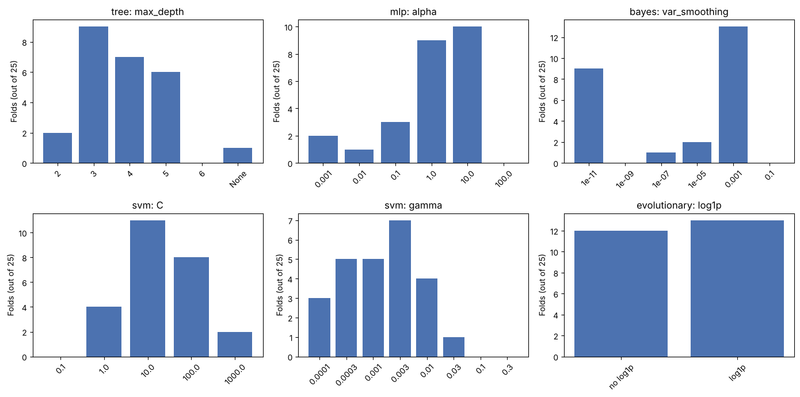

*Figure 13. How many of the 25 folds chose each value of the main hyper-parameters.* Single peaks mean a stable choice (tree depth, MLP `alpha`, Naive Bayes `var_smoothing`, SVM `C`); flat bars mean a plateau where several values are equally good (SVM `gamma`, `log1p` for the evolutionary learner).

- **Tree:** depth 3 to 5 in 22 of 25 folds; `entropy` in 16.
- **MLP:** `alpha` = 1 or 10 in 19 of 25 (strong regularization, consistent with collinearity); hidden layers (16) in 9, (4) in 8, (32, 16) in 5, (8) in 3.
- **Naive Bayes:** `log1p` in all 25 folds, as the skewness suggested; `var_smoothing` 1e-3 in 13.
- **SVM:** `C` = 10 in 11 and 100 in 8; `gamma` spread over a plateau from 1e-4 to 1e-2 (24 of 25).
- **Evolutionary:** indifferent to `log1p` (13 with, 12 without).
- **Edge selections that remain** (flagged by the code): MLP network size at the edge of the grid in 13 of 25 folds, `var_smoothing` in 9 and the tree's `min_samples_leaf` in 12 (10 of those 12 are `min_samples_leaf = 1`, the natural minimum). The conclusions do not depend on these hyper-parameters, but a wider search could shift individual results slightly.

### The cost threshold

| Learner | Cost at 0.5 | Cost at chosen threshold | Saving | FN per fold | FP per fold |
|:--|:-:|:-:|:-:|:-:|:-:|
| SVM | 0.104 | 0.072 | 31% | 1.76 → 0.80 | 0.68 → 2.56 |
| Bayes | 0.183 | 0.136 | 25% | 2.96 → 1.88 | 1.84 → 3.00 |
| MLP | 0.103 | 0.087 | 16% | 1.76 → 1.16 | 0.60 → 2.08 |
| Evolutionary | 0.128 | 0.109 | 14% | 2.12 → 1.44 | 1.04 → 2.76 |
| Tree | 0.246 | 0.236 | 4% | 3.88 → 3.36 | 2.96 → 4.64 |

Choosing the threshold by cost lowers the cost for every learner: false negatives decrease in exchange for more false alarms, exactly the 5:1 trade-off asked for. The mean chosen threshold shows who is overconfident: 0.26 (SVM) and 0.24 (MLP), but only **0.03 for Bayes** (≤ 0.05 in 22 of 25 folds) and 0.08 for the evolutionary learner. The tree barely gains because its probabilities are very coarse.

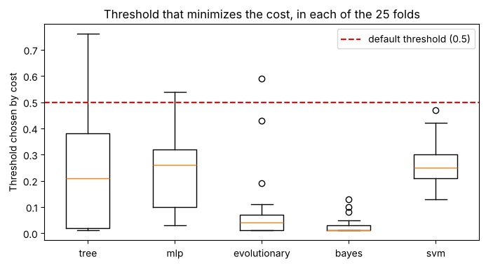

*Figure 14. Threshold that minimizes the cost, in each of the 25 folds.*

### Calibration

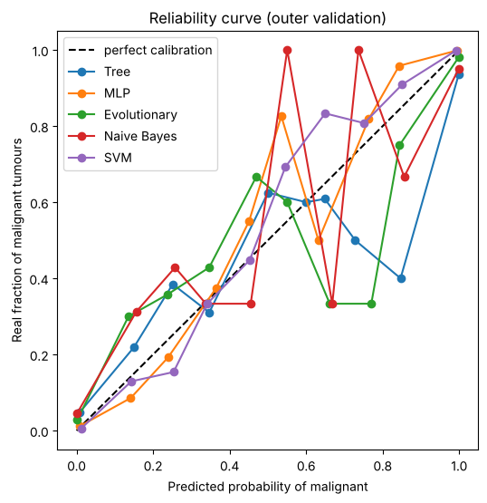

*Figure 15. Reliability curve on the outer-validation scores.* All five learners produce very extreme scores (between 73% for the SVM and 96% for Bayes are below 0.02 or above 0.98), so the middle of the curve has few points and says little. The difference shows better in the metrics: with nearly equal AUC (Bayes 0.988, MLP 0.994) the log-loss is **0.388 for Bayes versus 0.102 for the MLP**. Bayes ranks well, but when it errs it does so with almost total confidence. The tree is the worst calibrated (0.582). The evolutionary learner, whose sigmoid nobody optimized, is reasonably good (0.196).

### Final test (114 rows, 42 malignant, used once)

| Learner | Errors (0.5 threshold) | MCC | Recall | Cost |
|:--|:-:|:-:|:-:|:-:|
| SVM | 1 (1 FN) | 0.981 | 0.976 | 0.044 |
| MLP | 3 (3 FN) | 0.944 | 0.929 | 0.132 |
| Evolutionary | 3 (3 FN) | 0.944 | 0.929 | 0.132 |
| Bayes | 6 (5 FN, 1 FP) | 0.887 | 0.881 | 0.228 |
| Tree | 8 (6 FN, 2 FP) | 0.849 | 0.857 | 0.281 |

No difference is significant (exact McNemar of the MLP against the others: tree p = 0.18, Bayes 0.38, SVM 0.50, evolutionary 1.00). **With 42 malignant cases a single error moves recall by 2.4 points**; the 95% Wilson CI for the MLP's recall is [0.81, 0.98]. Test figures are somewhat higher than the CV's because 114 rows give a noisy estimate: the CV figures (25 folds) are the reliable ones. The test **did not change** the choice of best learner (MLP), fixed beforehand: SVM and MLP are a technical tie.

With the cost threshold chosen on the development set, Bayes improves (MCC 0.887 → 0.943; cost 0.228 → 0.096), the evolutionary learner too (cost 0.132 → 0.088), and the SVM gets slightly worse (cost 0.044 → 0.053, one more false alarm). But **the tree degenerates**: its threshold (0.03) labels everybody malignant (72 false positives, MCC 0, cost 0.632, the same as the baseline), because a shallow tree yields only a few distinct probabilities.

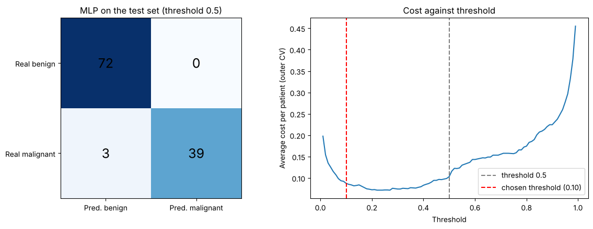

*Figure 16. Diagnosis of the MLP, the best by mean outer-CV MCC: confusion matrix on the test set at the 0.5 threshold, and cost against threshold in the outer CV.* At 0.5: 3 FN and 0 FP. In the reference run the cost threshold chosen on the whole development set was 0.10: 2 FN and 4 FP, and the test cost fell only from 0.132 to 0.123. On the second machine it was 0.37 and nothing changed (3 FN, 0 FP, cost 0.132). The mean of the 25 per-fold thresholds is 0.24. In both cases the gain of the cost threshold for this learner on the test set is zero or small.

### Error analysis

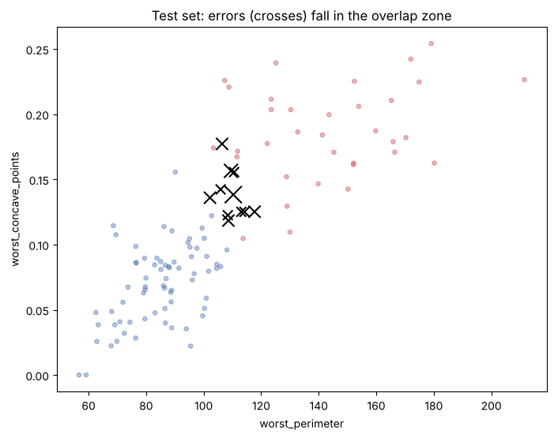

*Figure 17. Test set: where the learners fail (0.5 threshold), on `worst_perimeter` and `worst_concave_points`.* The 11 rows misclassified by some learner **fall in a narrow band** (`worst_perimeter` 102 to 118; `worst_concave_points` 0.12 to 0.18), the overlap zone of Figure 9. 103 of the 114 rows are classified correctly by all five. Only one is missed by **every** learner: a tumour that looks like the other class given these 30 measurements. This is a **limit of the data, not of the model**. Errors by learner: tree 8, Bayes 6, MLP 3, evolutionary 3, SVM 1.

### Evolutionary versus gradient

As a reference (not a sixth learner), logistic regression fitted by gradient reaches MCC 0.946 on the same 25 folds versus 0.926 for the evolutionary learner: difference −0.020, corrected p = 0.30, **indistinguishable**. One evolutionary fit costs 4,040 fitness evaluations and 0.2 s versus 7 to 10 ms for the gradient (**about 20 to 35 times more**; we measured 33, 35 and 21 times in different runs and machines), and the five seeds in Figure 2 end at different values. Evolution reaches about the same place, but at a higher cost. We did not test the part of the hypothesis saying that optimizing an asymmetric cost inside the evolution would minimize false negatives: the fitness was MCC.

### Answer to the hypothesis

| Claim in the hypothesis | Verdict | Evidence |
|:--|:--|:--|
| Success depends on redundancy and the threshold, not on complex boundaries | **Partly confirmed** | An evolved linear model ties with logistic regression and almost with MLP/SVM; the cost threshold lowers cost by 4% to 31% for all. But the top group includes a non-linear SVM |
| The connectionist will dominate | **Rejected as domination, confirmed as top group** | MLP first on MCC (0.945) but ties with SVM (p ≈ 0.9) and evolutionary (p = 0.32); only the tree is significantly worse |
| Bayes overconfident, with a worse threshold | **Mostly confirmed on calibration** | Log-loss 0.388 vs 0.102 with nearly equal AUC; its chosen threshold is extreme (0.03 on average). But its cost still drops 25% when chosen by cost |
| Tree readable but worse calibrated | **Confirmed, stronger than expected** | Worst MCC (0.841), worst log-loss (0.582) and a degenerate cost threshold on the test |
| Analogizer hurt by correlations | **Rejected** | The RBF SVM ties with the MLP, has the lowest CV cost (0.072) and the best test; standardization and the kernel absorb the redundancy |
| Evolutionary: matches, but blind search is expensive | **Confirmed on cost, not on quality** | Ties with logistic regression (p = 0.30), 20 to 35 times slower, seeds end at different values |

### Limits

- **Small sample:** test of 114 rows with 42 malignant; the test confirms but does not discriminate.
- **Ceiling effect:** MLP, SVM, evolutionary and Bayes are indistinguishable; no conclusion allows saying that one "wins".
- **The 5:1 cost is an assumption**, not clinical data; another ratio would change thresholds and perhaps the cost ranking.
- **The threshold is chosen from training scores:** it works with graded scores and breaks with very coarse ones (tree).
- **Grids widened three times** (Section 2) and some edge selections remain (Section 5).
- **One dataset and one institution:** no external validation. This is not a diagnostic device.
- **Irreducible errors:** failures concentrate in an overlap zone of the features themselves.
- **Stack:** we did not use JAX or Keras (`MLPClassifier` was used, which the assignment allows) and computations rely on numpy and scikit-learn.
- **Reproducibility across machines:** results were produced on one environment; other versions can change the third decimal.

### Next steps

1. Repeat with other datasets from the list (e.g. `german_credit`, with real 5:1 costs) to see whether the technical tie is specific to the ceiling effect of `breast_cancer`.
2. Calibrate the probabilities (isotonic or Platt) **before** fixing the threshold, especially for tree, Bayes and evolutionary.
3. Try an evolutionary learner with the **asymmetric cost as fitness**.
4. Give bootstrap confidence intervals to the threshold and the test recall.
5. Add an ensemble (random forest or boosting) as an extension, justifying its class.

---

## Appendix · Files and how to run it

`results/` is not in the repository: Phase 5 creates it.

```
01_phase1_context_jupyter.ipynb / _python.py       Phase 1  context and task
02_phase2_visualization_...                        Phase 2  data visualization and decisions
03_phase3_methodology_...                          Phase 3  evaluation protocol
04_phase4_models_...                               Phase 4  the five learners
05_phase5_tuning_...                               Phase 5  nested cross-validation and tuning (~5 min)
06_phase6_evaluation_...                           Phase 6  comparison, final test, conclusions
utils_python.py                                    shared functions (data loading, folds, metrics, t-test)
models_python.py                                   the five learners (including the evolutionary one)
datasets/breast_cancer.csv.zst                     the data
requirements.txt                                   the libraries the code uses
README.md                                          this file
figures/                                           reference figures (regenerated when the phases run)
```

Each phase exists in two forms with identical code: a Jupyter notebook (`_jupyter.ipynb`, with explanations) and a script (`_python.py`, with `# %%` cells, one comment per line).

**To run it:**

1. Clone this repository (`git clone https://github.com/javierrubioechevarria-lab/ml-model-comparison.git`) and open the folder in VS Code, or open a terminal in it. The data path is `datasets/breast_cancer.csv.zst`, relative to this folder.
2. Use Python 3.12 or 3.13 (the reference run used 3.13) and install the libraries in the same interpreter that runs the code:
   ```
   python -m pip install -r requirements.txt
   ```
   The code needs polars, numpy, scipy, matplotlib, seaborn, scikit-learn and pyBlindOpt (plus ipykernel and nbformat to run the notebooks). We did not use JAX or Keras. These libraries are all part of the course environment. We ran the six phases in a virtual environment created from the course repository with `pip install .` (the manual alternative to `make venv`, without its OpenBLAS source build), and all of them finished without errors; the versions are those listed in Section 4, with numpy 2.5.4 instead of 2.5.3.
3. Run the phases **in order, 1 to 6**. Phase 5 saves `results/*.csv` and Phase 6 reads them.
4. Phase 5 takes about 5 minutes in the reference run and prints nothing while each learner is being tuned; it prints one line per learner when it finishes it.

Notes:
- With `python file.py`, each `plt.show()` **blocks** until its window is closed (the window may be hidden behind the editor). To avoid it, run the script in the VS Code Interactive Window ("Run Current File in Interactive Window") or set `MPLBACKEND=Agg` first (PowerShell: `$env:MPLBACKEND="Agg"`). The images are saved to `figures/` either way.
- If Windows (Smart App Control or a managed-PC policy) blocks a `scipy` file with "DLL load failed ... una directiva de Control de aplicaciones bloqueó este archivo", the code is not at fault. Run it on another machine or in Google Colab (upload the files and `datasets/`, then `!pip install polars pyBlindOpt`).

---

*References.* Domingos, P. (2015), *The Master Algorithm*. Nadeau, C. and Bengio, Y. (2003), *Inference for the generalization error*, Machine Learning 52. Wolberg, W. H., Street, W. N., Mangasarian, O. L. (1995), *Breast Cancer Wisconsin (Diagnostic)*, UCI Machine Learning Repository.
